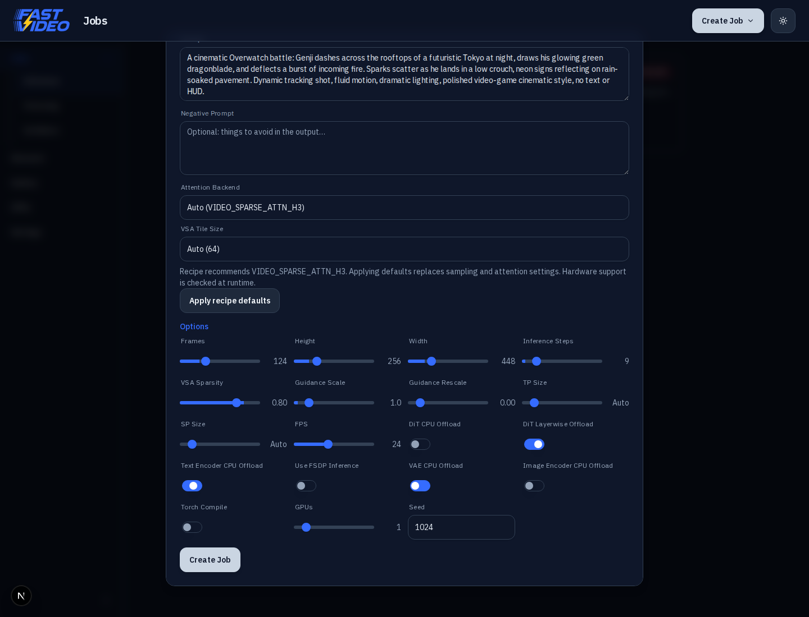

# FastVideo Studio

A lightweight web-based UI for interacting with FastVideo.

## Features

The UI currently supports:

- Inference
- Finetuning & Distillation
- Datasets
- Gallery View

## Project Structure

```
apps/fastvideo_studio/
├── server.py / job_runner.py / database.py   # FastAPI backend + job lifecycle
├── mock_server.py                            # In-memory API mock for e2e tests
├── models/                                   # Pydantic request models (shared with the mock)
├── training_config.py                        # Studio workloads → fastvideo/train YAML configs
├── tests/                                    # Backend unit tests (pytest)
├── e2e/                                      # Playwright specs (run against the mock)
└── src/
    ├── app/                                  # Next.js App Router pages (thin routes)
    ├── components/
    │   ├── shell/                            # App chrome: header, sidebars, layout
    │   ├── jobs/                             # Job queue, cards, create-job modal, log sidebar
    │   ├── datasets/                         # Dataset cards, upload, captions
    │   └── ui/                               # shadcn-style primitives (shared theme)
    ├── stores/                               # Framework-agnostic state + React bridge (hooks/)
    ├── lib/                                  # API client, types, option persistence
    └── test/                                 # Vitest setup + factories
```

The visual theme (slate light/dark palettes, IBM Plex type, `#356cff` accent)
is shared with `apps/dreamverse`; the toggle in the header persists the choice
per browser.

## Testing

```bash
npm run typecheck        # tsc
npm test                 # vitest unit tests
npm run e2e              # Playwright against the in-memory mock backend
python -m pytest tests/  # backend unit tests (from apps/fastvideo_studio)
```

## Quick Start

For local development, install dependencies and start the Next.js dev server:

```bash
cd apps/fastvideo_studio
npm install
npm run dev
```

You can then access the app at [http://localhost:3000](http://localhost:3000).
Start the Python API server (default port 8189) in a separate terminal — see below.

For a production build of the web app together with the API server:

```bash
cd apps/fastvideo_studio
npm install
npm run build
npm run start:all
```

### Running API and Web Separately

The UI is composed of two separate components:

- API Server
- Web Server

To run each component separately, you can use the commands `npm run start:web` (after `npm run build`) and `npm run start:api`.

You can also run the API server with this command from the `apps/` directory:

```bash
python -m fastvideo_studio.server --output-dir /path/to/videos --log-dir /path/to/logs
```

Running it this way allows you to pass command line parameters.

The API server defaults to port 8189. To configure this, you can edit `.env.local` file.
Refer to `.env.example` for reference.

### API Endpoints

| Method   | Path                          | Description                                |
| -------- | ----------------------------- | ------------------------------------------ |
| `GET`    | `/api/models`                 | List available models                      |
| `GET`    | `/api/jobs`                   | List all jobs (newest first)               |
| `GET`    | `/api/jobs/{id}`              | Get a single job's details                 |
| `POST`   | `/api/jobs`                   | Create a new job                           |
| `POST`   | `/api/jobs/{id}/start`        | Start a pending/stopped/failed job         |
| `POST`   | `/api/jobs/{id}/stop`         | Request a running job to stop              |
| `DELETE` | `/api/jobs/{id}`              | Delete a job                               |
| `GET`    | `/api/jobs/{id}/video`        | Stream the generated video/image           |
| `GET`    | `/api/jobs/{id}/logs`         | Get job logs (polling, supports `?after=`) |
| `GET`    | `/api/jobs/{id}/download_log` | Download the job's log file                |

## Per-job attention settings

Inference jobs expose **Attention Backend** and **VSA Tile Size**. An explicit
job backend takes priority, followed by a server/environment override. With
neither set, Auto uses the backend from a matching self-contained T2V serving
recipe, then falls back to FastVideo's core selection. An unset tile uses the
matching recipe's tile when the resolved backend agrees with that recipe.
Unknown models, non-T2V workloads and pipeline overrides keep the core defaults.
The form previews the Auto selection; logs record requested and resolved values.
Auto does not change sampling steps, guidance, frame count or offload settings. A backend appearing in the list does not guarantee that the
current model or hardware supports it. Core checkpoint checks remain enabled.

When a matching text-to-video serving YAML with an explicit backend and no
component or quantization overrides exists under `examples/serving`,
**Apply recipe defaults** copies its attention and sampling settings into the
form. This is an explicit replacement of those fields; opening the form or
changing models does not silently overwrite them. GPU count and CPU offload
remain under the user's control. FastH3 8-Step V2 uses 9 sigma-grid points
(8 transformer forwards), guidance 1, VSA sparsity 0.8 and tile size 64.

Backend and tile selections are persisted with the job, survive edit/duplicate
and server restart, and participate in generator cache identity. Old databases
migrate to Auto for both backend and tile size. For a matching T2V recipe,
previously unset attention fields now resolve from that recipe at execution.



## Task execution and isolation

Starting a job places it in a FIFO queue (`queued`). One persistent scheduler
thread executes jobs serially, including training, so this Studio instance does
not concurrently allocate the same visible GPUs. Queued jobs can be cancelled;
running inference stops cooperatively after loading or generation completes.
This does not reserve GPUs against other applications.

Inference always uses FastVideo's multiprocessing executor, even with one GPU.
Model parallel groups and initialization cleanup therefore live in worker
processes rather than the API process. Studio retains one generator for reuse
by the same effective configuration. Switching models/settings releases the
previous workers before loading; an inference error evicts the cached generator.
Restarting the API marks interrupted queued/running jobs failed rather than
silently replaying them. Queued jobs cannot be edited or started twice.
