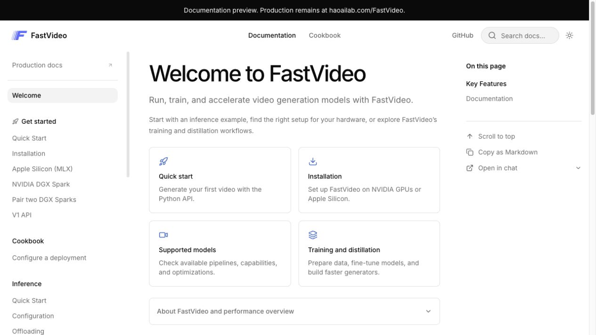

# FastVideo Blume documentation

This Blume app previews the FastVideo documentation and the React cookbook from
[cookbook migration #1949](https://github.com/hao-ai-lab/FastVideo/issues/1949).
MkDocs continues to publish production while this transfer is reviewed.



## Run locally

Use Node 22.19 or newer and Python 3.12. From the repository root:

```bash
uv venv docs-site/.venv --python 3.12
uv pip install --python docs-site/.venv/bin/python -r requirements-mkdocs.txt
npm ci --prefix docs
npm ci --prefix docs-site
npm run dev --prefix docs-site
```

Open the URL printed by Blume, under `/FastVideo`. The production prefix also
applies locally. The first preparation builds the Python reference and takes
about a minute on a laptop. Subsequent runs reuse it until its source changes.
You can select an existing docs environment with `DOCS_PYTHON=/path/to/python`.
No FastVideo installation, model weights, or GPU runtime is needed.

For a production build and preview:

```bash
npm run check --prefix docs-site
npm run build --prefix docs-site
npm run validate --prefix docs-site
npm run preview --prefix docs-site
```

Build output is `docs-site/dist/`. This draft adds a CI build artifact, not a
production deployment. The existing MkDocs Pages workflow remains authoritative.

## Edit the documentation

Keep editing handwritten guides under `docs/`. The Blume welcome page is
`content/index.mdx`; it includes the original homepage material through generated
partials. Run `npm run prepare:content --prefix docs-site`
after changing those pages or Python sources, then restart the dev server. This
transition build regenerates the Blume copy rather than maintaining two editable
versions. Do not edit or commit `.generated/` or `public/`.

The transfer has three parts:

- `scripts/prepare-python-docs.py` runs the existing example generator and
  `mkdocs-api-autonav` / `mkdocstrings` against source files. It caches the comparison
  build by content hash and extracts the Python reference's semantic HTML, without
  Material's navigation or page shell. It imports no FastVideo runtime modules.
- `scripts/transfer-docs.mjs` copies non-cookbook Markdown, runs Blume's pinned
  MkDocs codemod, preserves old routes and heading IDs, translates local links,
  copies images, and recreates the declared navigation. It embeds the rendered
  API in the Blume shell, with links to child modules for discovery.
- Handwritten Blume pages under `content/`, including the cookbook, overlay the
  generated tree. Cookbook runbook links continue to the existing production site.
  The cookbook UI, manifests, and design are not changed by this transfer.

The output includes the homepage, installation, inference, training, distillation,
attention, utilities, design, contributor guides, contact page, generated examples,
and Python API. Existing URLs and headings are checked against the comparison
build. The conversion log is `.generated/conversion-report.log`, and Python build
diagnostics are in `.generated/mkdocs-build.log`.

MkDocs remains a build dependency for the Python reference during this transition.
Replacing its renderer can happen later without losing the source-generated API.
The ordinary content uses Blume Markdown/MDX. The welcome cards, visible search
control, and quieter navigation take inspiration from
[Specific's documentation](https://docs.specific.dev/) while keeping FastVideo's
blue branding. Material buttons become plain links,
Slurm blocks use Bash highlighting, and GitHub's homepage buttons keep their links
without loading the external widget script. Search, code copying, image zoom, theme
switching, and page feedback use Blume's built-ins. Production deployment stays on
the existing workflow until the cookbook and full-site preview are approved.

## Extend the cookbook

`islands/Cookbook.tsx` owns the React UI and its loading/edit state. Shared
configuration behavior stays in `docs/js/cookbook-config.mjs`. The typed adapter
in `lib/cookbook.ts` describes the part of that existing contract used by this UI.
Read [the API contract](../docs/cookbook/design.md) and
[recipe authoring guide](../docs/contributing/cookbook_configuration.md) before
adding fields or recipes.

- Keep native serving YAMLs and `docs/cookbook/recipes/` as the source of truth.
  Do not add another recipe database or hardcode field lists in the UI.
- Use `getOptions` for field metadata and `resolveConfig` for validated YAML,
  server commands, and client instructions. Clear generated output when invalid.
- The URL stores the selected deployment. Edit values stay local to the page;
  URL serialization of all edited values is follow-up work.
- Reset restores the baseline. Missing fields remain inherited. Explicit `false`,
  `0`, and `null` keep their meanings. Switching deployments discards edits.
- Installation and deployment guides link to the existing published MkDocs site.
  `guideUrl` resolves metadata against that site's index until those pages migrate.
- VRAM fit is unknown. Add a calculator or a verified-run badge only with the
  measurements and evidence contract described in #1949.

Blume builds the documentation shell with Astro. Components in `islands/` are
ordinary React; `client = "load"` enables hydration. `components/ui/` contains
editable shadcn components, `components.json` configures the CLI, and `theme.css`
maps their tokens to Blume's light/dark palette. Blume supplies Tailwind and reads
`tsconfig.json` aliases. Add components from this directory:

```bash
npx shadcn@4.21.5 add dialog
```

The two npm overrides keep Astro's React integration and React plugin aligned
with the versions used by Blume 2.2.3. Without them, npm's resolver cycles between
the integration's newer plugin and Blume's pinned plugin. Recheck and remove the
overrides when upgrading Blume.

The initial dependency audit reports 10 transitive advisories in Blume's dependency
tree, including its unused Vercel adapter and Markdown build dependencies. The
ordinary `npm audit fix` does not clear them; review upstream fixes before
production deployment. Do not apply `npm audit fix --force`, whose proposed
replacement is `blume@0.0.0`.

## Verify UI changes

```bash
npm run format:check --prefix docs-site
npm run check --prefix docs-site
npm run test:cookbook --prefix docs
npm run build --prefix docs-site
npm run validate --prefix docs-site
npm run test:content --prefix docs-site
cd docs-site
npx playwright install chromium
npm test
```

The browser suite starts a production preview. It checks edits and downloads,
invalid-output suppression, reset, switching runtimes, retry, obsolete loads,
keyboard editing, and mobile overflow under `/FastVideo`. Keep shared API tests
in `docs/tests/`; add React interaction tests here. No serving process is launched.

## Before switching production

The transfer keeps the old documentation available. Before changing the Pages
workflow, finish the cookbook design and remaining recipe migration from #1949,
review the new docs at desktop and mobile widths, and resolve the dependency
audit findings noted above. Keep the current Python renderer until a replacement
preserves its API pages, aliases, and cross references. No old pages or recipes
are removed by this preview.
