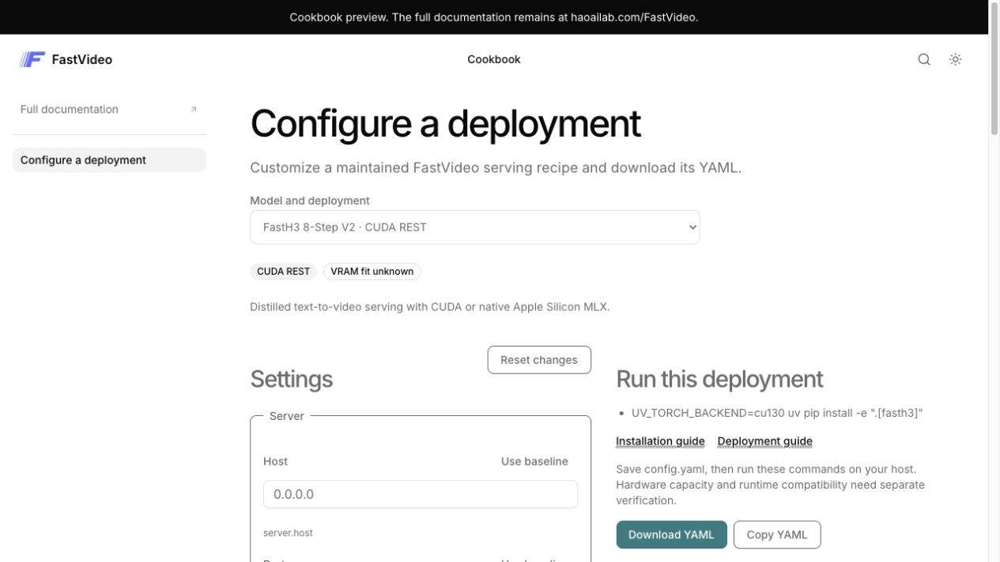

# FastVideo Blume cookbook

This is the initial Blume documentation app for [cookbook migration #1949](https://github.com/hao-ai-lab/FastVideo/issues/1949).
It uses React islands and shadcn/ui. MkDocs continues to publish the full documentation.



## Run locally

Use Node 22.19 or newer. From the repository root:

```bash
npm ci --prefix docs
npm ci --prefix docs-site
npm run dev --prefix docs-site
```

Open the URL printed by Blume, under `/FastVideo/cookbook`. The production prefix
also applies locally. `predev` generates the shared cookbook catalogs and copies
them into this app's ignored `public/` directory. No Python, model weights, or
GPU runtime is needed.

For a production build and preview:

```bash
npm run check --prefix docs-site
npm run build --prefix docs-site
npm run validate --prefix docs-site
npm run preview --prefix docs-site
```

Build output is `docs-site/dist/`. This draft adds a CI build artifact, not a
production deployment. The existing MkDocs Pages workflow remains authoritative.

## Extend the cookbook

`islands/Cookbook.tsx` owns the React UI and its loading/edit state. Shared
configuration behavior stays in `docs/js/cookbook-config.mjs`. The typed adapter
in `lib/cookbook.ts` describes the part of that existing contract used by this UI.
Read [the API contract](../docs/cookbook/design.md) and
[recipe authoring guide](../docs/contributing/cookbook_configuration.md) before
adding fields or recipes.

- Keep native serving YAMLs and `docs/cookbook/recipes/` as the source of truth.
  Do not add another recipe database or hardcode field lists in the UI.
- Use `getOptions` for field metadata and `resolveConfig` for validated YAML,
  server commands, and client instructions. Clear generated output when invalid.
- The URL stores the selected deployment. Edit values stay local to the page;
  URL serialization of all edited values is follow-up work.
- Reset restores the baseline. Missing fields remain inherited. Explicit `false`,
  `0`, and `null` keep their meanings. Switching deployments discards edits.
- Installation and deployment guides link to the existing published MkDocs site.
  `guideUrl` resolves metadata against that site's index until those pages migrate.
- VRAM fit is unknown. Add a calculator or a verified-run badge only with the
  measurements and evidence contract described in #1949.

Blume builds the documentation shell with Astro. Components in `islands/` are
ordinary React; `client = "load"` enables hydration. `components/ui/` contains
editable shadcn components, `components.json` configures the CLI, and `theme.css`
maps their tokens to Blume's light/dark palette. Blume supplies Tailwind and reads
`tsconfig.json` aliases. Add components from this directory:

```bash
npx shadcn@4.21.5 add dialog
```

The two npm overrides keep Astro's React integration and React plugin aligned
with the versions used by Blume 2.2.3. Without them, npm's resolver cycles between
the integration's newer plugin and Blume's pinned plugin. Recheck and remove the
overrides when upgrading Blume.

The initial dependency audit reports 10 transitive advisories in Blume's dependency
tree, including its unused Vercel adapter and Markdown build dependencies. The
ordinary `npm audit fix` does not clear them; review upstream fixes before
production deployment. Do not apply `npm audit fix --force`, whose proposed
replacement is `blume@0.0.0`.

## Verify UI changes

```bash
npm run format:check --prefix docs-site
npm run check --prefix docs-site
npm run test:cookbook --prefix docs
npm run build --prefix docs-site
npm run validate --prefix docs-site
cd docs-site
npx playwright install chromium
npm test
```

The browser suite starts a production preview. It checks edits and downloads,
invalid-output suppression, reset, switching runtimes, retry, obsolete loads,
keyboard editing, and mobile overflow under `/FastVideo`. Keep shared API tests
in `docs/tests/`; add React interaction tests here. No serving process is launched.

## Finish the documentation migration

This is a cookbook-first setup, not a completed MkDocs content migration. Blume's
`migrate mkdocs --codex` command launches an agent with its bundled migration
skill; the initial setup follows that workflow directly. Full-site migration
should proceed in reviewable batches:

1. Inventory the current MkDocs sitemap, navigation, heading anchors, generated
   examples, legacy cookbook URL state, assets, hooks, and plugins.
2. Convert pages into `content/` using Blume's bundled MkDocs codemod. Review
   admonitions, tabs, math, snippets, and raw HTML. Preserve old paths and anchors.
3. Choose how to publish Python API docs. Blume does not replace `mkdocstrings`
   or `api-autonav`. Keep the current reference reachable until a replacement works.
4. Migrate remaining legacy cookbook recipes and interaction scenarios from
   #1949. Keep runbooks, setup steps, environment variables, and hardware evidence.
5. Compare old URLs against the built preview, review desktop/mobile and both
   themes, then switch the Pages build. Retire legacy assets only after checking
   their remaining consumers.

No old pages, hooks, recipes, or deployment paths are removed by this setup.
