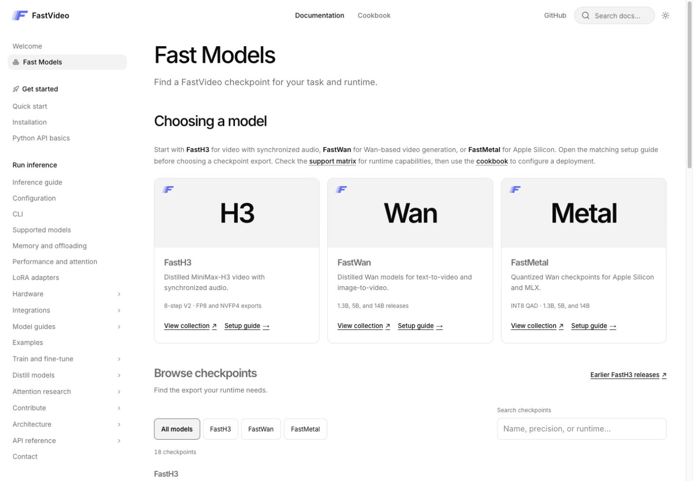

# FastVideo documentation

Blume builds the documentation and React cookbook at
[haoailab.com/FastVideo](https://haoailab.com/FastVideo/). This PR replaces the
previous MkDocs site using the existing GitHub Pages publishing workflow.




## Develop and validate

Read [Documenting FastVideo](../docs/contributing/documentation.md) for setup,
commands, source ownership, and the per-page writing template. Use Node 24 and
Python 3.12. `npm run dev --prefix docs-site` serves under `/FastVideo`.
`npm run build --prefix docs-site` prepares the content and writes `dist/`.
`npm run preview --prefix docs-site` serves that static build.

Edit canonical guides under `docs/`, the welcome page under `content/`, the model
catalog in `lib/fast-models.ts`, and sidebar grouping in `navigation.json`.
Preparation regenerates `.generated/` and `public/`; neither is an editable copy.

The [documentation structure plan](INFORMATION_ARCHITECTURE.md) records the new
navigation and proposed page consolidations. URLs stay stable in this PR.
Hardware, integrations, and model guides now sit beneath Run inference rather
than interrupting the getting-started path.

## Build architecture

- `scripts/prepare-python-docs.py` uses Griffe to extract modules, classes,
  signatures, docstrings, and source directly from Python files. It never imports
  FastVideo or needs PyTorch. Only Griffe, Markdown, and PyYAML are installed from
  `requirements-docs.txt`. It also regenerates examples and serving metadata.
- `scripts/transfer-docs.mjs` uses Blume's pinned Markdown syntax normalizer,
  rewrites links, preserves fragments, copies assets, and overlays the handwritten
  application pages. `content-syntax.yml` configures syntax compatibility only.
- `migration-anchors.json` is a frozen compatibility contract for the previous
  site's URLs and heading fragments. Tests check the published output against it.
  Do not regenerate it to hide missing routes or anchors.
- `scripts/prepare-content.mjs` builds and copies cookbook catalogs and assets.
  Existing family recipe selectors are scoped inside the new shell while the
  React editor and cookbook design continue to develop.
- `.github/workflows/infra-docs.yml` validates and uploads `docs-site/dist/` with
  the existing Pages actions. Deployment runs only on `main`. The domain,
  environment and `/FastVideo` prefix are unchanged.

## Homepage and catalog

The welcome page uses Blume frame mode for its centered logo and accessible
heading. News comes from the first two dated entries under `NEWS` in the root
README; projects come from its Awesome work section. The original introduction
and key features come from canonical `docs/index.md`.

The star button fetches GitHub's public repository count on load and every five
minutes while visible. Failed initial requests show "Star"; failed refreshes
retain the previous count. No credentials are used. The Trendshift badge loads
from Trendshift. The lab mark in `assets/hao-ai-lab.png` is the supplied image.

Fast Models uses family cards, setup links, family filters, search, and consistent
checkpoint rows. The curated links were checked against the public Hugging Face
API on October 16, 2026. Published weights do not establish runtime or hardware
compatibility. Check the support matrix and matching setup guide.

## Extend the cookbook

`islands/Cookbook.tsx` owns the React UI and its loading/edit state. Shared
configuration behavior stays in `docs/js/cookbook-config.mjs`. The typed adapter
in `lib/cookbook.ts` describes the part of that existing contract used by this UI.
Read [the API contract](../docs/cookbook/design.md) and
[recipe authoring guide](../docs/contributing/cookbook_configuration.md) before
adding fields or recipes.

- Keep native serving YAMLs and `docs/cookbook/recipes/` as the source of truth.
  Do not add another recipe database or hardcode field lists in the UI.
- Use `getOptions` for field metadata and `resolveConfig` for validated YAML,
  server commands, and client instructions. Clear generated output when invalid.
- The URL stores the selected deployment. Edit values stay local to the page;
  URL serialization of all edited values is follow-up work.
- Reset restores the baseline. Missing fields remain inherited. Explicit `false`,
  `0`, and `null` keep their meanings. Switching deployments discards edits.
- Installation and deployment guides resolve against the current origin and
  deployment prefix. Family runbook URLs remain available in the Blume site.
- VRAM fit is unknown. Add a calculator or a verified-run badge only with the
  measurements and evidence contract described in #1949.

Blume builds the documentation shell with Astro. Components in `islands/` are
ordinary React; `client = "load"` enables hydration. `components/ui/` contains
editable shadcn components, `components.json` configures the CLI, and `theme.css`
maps their tokens to Blume's light/dark palette. Blume supplies Tailwind and reads
`tsconfig.json` aliases. Add components from this directory:

```bash
npx shadcn@4.21.5 add dialog
```

The two npm overrides keep Astro's React integration and React plugin aligned
with the versions used by Blume 2.2.3. Without them, npm's resolver cycles between
the integration's newer plugin and Blume's pinned plugin. Recheck and remove the
overrides when upgrading Blume.

The initial dependency audit reports 10 transitive advisories in Blume's dependency
tree, including its unused Vercel adapter and Markdown build dependencies. The
ordinary `npm audit fix` does not clear them; review upstream fixes before
production deployment. Do not apply `npm audit fix --force`, whose proposed
replacement is `blume@0.0.0`.

## Verify UI changes

```bash
npm run format:check --prefix docs-site
npm run check --prefix docs-site
npm run test:cookbook --prefix docs
npm run build --prefix docs-site
npm run validate --prefix docs-site
npm run test:content --prefix docs-site
cd docs-site
npx playwright install chromium
npm test
```

The browser suite starts a production preview. It checks edits and downloads,
invalid-output suppression, reset, switching runtimes, retry, obsolete loads,
keyboard editing, and mobile overflow under `/FastVideo`. Keep shared API tests
in `docs/tests/`; add React interaction tests here. No serving process is launched.

## Review and follow-up

This PR switches the existing Pages artifact from MkDocs to Blume when merged.
The original routes and fragments are checked against the frozen migration
manifest. Review CI and the catalog/sidebar on desktop and mobile before merging.
The remaining cookbook design and editor coverage in #1949 can continue without
keeping a second documentation build. The editorial consolidation proposals are
listed separately in `INFORMATION_ARCHITECTURE.md`.
